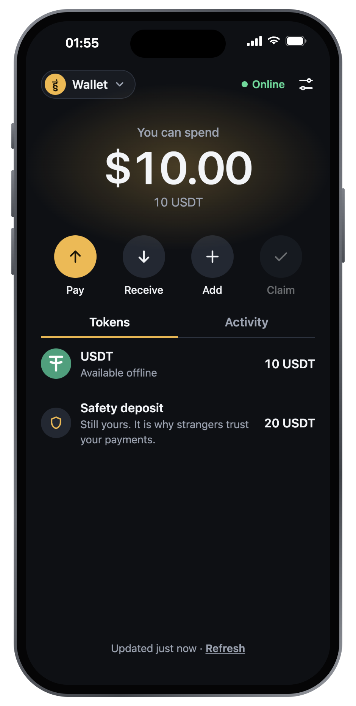
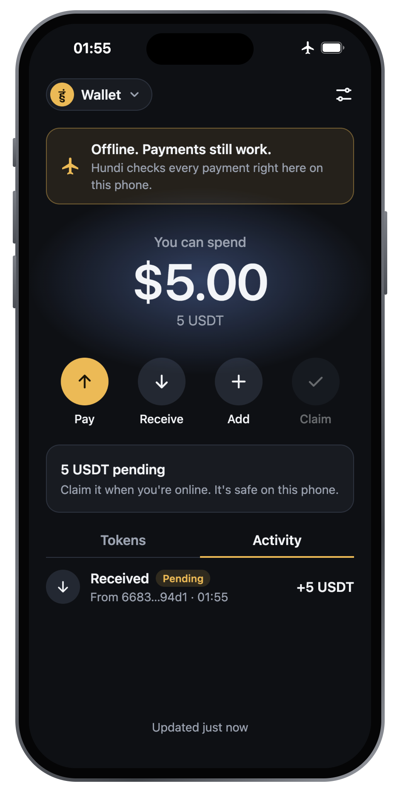
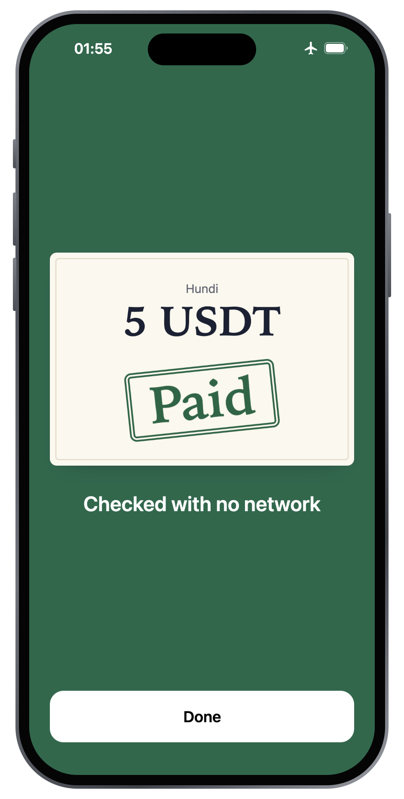
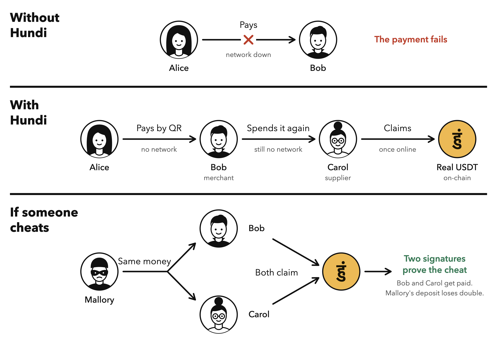

<div align="center">
  
  <h1>Hundi</h1>
  <p><b>Money that works when the network doesn't.</b></p>
  <p>Pay in USDT from a phone in airplane mode. The person you pay can spend that money again, also offline.<br>If someone spends the same money twice, the contract takes it from their deposit.</p>
  <p>
    <a href="https://hundi-ten.vercel.app"><b>Try the wallet</b></a> ·
    <a href="https://hundi-chai.vercel.app">Chai shop demo</a> ·
    <a href="https://explorer.testnet.whitechain.io/address/0x422d3a4745cfdeb1be99772ef636e827c892c45a">Contract</a> ·
    <a href="docs/HOW-IT-WORKS.md">How it works in detail</a>
  </p>
</div>

<p align="center">
  
  
  
</p>

Built at ETHGlobal Mumbai 2026. Everything runs on the Whitechain Sepolia testnet, chain 1874, so no real money moves.

## The problem

- Access Now counted [313 internet shutdowns in 52 countries in 2025](https://www.business-standard.com/india-news/india-records-65-internet-shutdowns-2025-access-now-report-126033100877_1.html), 65 of them in India.
- During a shutdown, wallets and payment apps stop working.
- Apps that queue a payment until the network returns give the receiver nothing they can check or spend.

For centuries, Indian merchants used the hundi, a paper note that passed from hand to hand and was cashed later. Hundi does the same with USDT.

## How it works



Alice added USDT and a safety deposit while online. Now she wants a chai from Bob, and nobody has signal.

1. Alice scans Bob's code and shows hers. Bob's phone checks the payment with no network and shows **Paid**.
2. Bob pays his supplier Carol with the same money, also offline.
3. Carol gets signal and taps **Claim**. The USDT arrives in her account. She doesn't need gas or a seed phrase.

Now Mallory pays Bob and Carol with the same money. Both phones accept it, because neither can see the other's payment while offline. When they claim, the contract finds two signatures from Mallory for the same money, which proves she cheated. Bob and Carol both get paid. Mallory's deposit loses twice the amount. Half pays the victim, and half stays locked in the contract forever.

Offline, nothing can prevent a double-spend. Hundi proves it afterwards and charges the cheater.

## Transactions on Whitechain

| What happened | Transaction |
| --- | --- |
| An iPhone in airplane mode paid a laptop by camera, then claimed through the relayer | [0x13d4...e589](https://explorer.testnet.whitechain.io/tx/0x13d45e60b0a2446c156cdda4e6e834cc39cd19bae3df4b873cd366d3aeaee589) |
| A double-spend, paid from the cheater's deposit | [0xc2d1...8ec7](https://explorer.testnet.whitechain.io/tx/0xc2d1f8fd58de4703724456dbeeae6fb27e0166e7a8974a8d905ce4585a9c8ec7) |
| Claimed directly, with the relayer switched off | [0xaee9...bca8](https://explorer.testnet.whitechain.io/tx/0xaee94522ed28b70cb12c74c9e83c9bb1fac84a3bcd83fa2c63b28ebccfbcbca8) |
| The relayer bought its own gas on Uniswap | [0x257e...2725](https://explorer.testnet.whitechain.io/tx/0x257e04889dbdbe086acff4953a25b8b42fdcaf5de9a97407a4f9115784982725) |

## Why this needs on-chain settlement

Anyone who receives a payment must be able to cash it out without asking an operator. A card network or a company database needs a live connection at the moment of payment, and a government can order it shut down. An offline phone can't enforce anything after the payment. Whitechain does that. It holds the USDT in escrow and takes the deposit from anyone who signs twice.

## Setup

You need [Bun](https://bun.sh) 1.4.4 and [Foundry](https://getfoundry.sh) 1.9.0.

```sh
git clone --recurse-submodules https://github.com/ratik21/hundi
cd hundi && bun install
bun run test
bun run lab
```

`bun run lab` starts three wallets and the chai shop on a local fork, at `localhost:5191` to `5194`. The [full setup guide](docs/HOW-IT-WORKS.md#setup-in-full) covers simulators and deploying your own vault.

## Architecture

```text
contracts        The vault that holds USDT and deposits
packages/core    Pure logic, including the offline payment check
packages/wallet  Keys, storage, QR codes and the drop-in widget
apps/pwa         The wallet app
apps/shop        A demo chai shop that uses the widget
apps/relayer     Optional service that pays gas for a fee
```

## Built with

**Whitechain.** [`HundiVault`](https://explorer.testnet.whitechain.io/address/0x422d3a4745cfdeb1be99772ef636e827c892c45a) is verified on chain 1874 and settles USDT. Phones sign with P-256 keys, and the chain's `0x100` precompile checks the signatures. Payers never hold WBT, and no payment screen names a chain.

**Drop-in widget.** A shop adds Hundi with the 21 lines in [`apps/shop/src/main.ts`](apps/shop/src/main.ts). It gets a merchant view, a customer view and a CSV export for the accountant.

**Gas.** The relayer pays gas and takes 0.10 USDT from the payout, so a 5 USDT payment pays 4.90. It accepts only vault calls, and refuses anything that fails simulation or would not cover its gas. See the [gas details](docs/HOW-IT-WORKS.md#gas).

**Uniswap.** The relayer earns USDT and spends WBT, so it buys its own gas through the v3 `SwapRouter02` at `0xe208cc685cd95d56e8ec6dec9816476567fc6962`.

| What | Code |
| --- | --- |
| Swap USDT for wrapped WBT, then unwrap it | [`refill.ts#L38-L62`](https://github.com/ratik21/hundi/blob/b8d93cf/apps/relayer/src/refill.ts#L38-L62) |
| Simulate the `multicall`, then send it | [`refill.ts#L112-L119`](https://github.com/ratik21/hundi/blob/b8d93cf/apps/relayer/src/refill.ts#L112-L119) |
| When to refill, and the price floor | [`policy.ts#L72-L82`](https://github.com/ratik21/hundi/blob/b8d93cf/apps/relayer/src/policy.ts#L72-L82) |
| Run the refill after replying to the caller | [`handler.ts#L88-L96`](https://github.com/ratik21/hundi/blob/b8d93cf/apps/relayer/src/handler.ts#L88-L96) |

## CROPS

Censorship resistance is Hundi's main property. Payments need no server, and claiming works with the relayer switched off.

**C.** This project controls two domains, the relayer and the default RPC. If the relayer stops, **Submit directly** claims from the device. If the RPC fails, reads fall back to Ankr. An installed app keeps working if the domains go away, and the vault has no owner.

**O.** MIT license. Anyone can build and run all of it from this repo, including the relayer.

**P.** The public RPC sees your IP address and what you read. The relayer sees your IP address and payout address, and Vercel sees your IP address. There are no analytics or trackers. Claimed payments are public on-chain.

**S.** Your P-256 key is non-extractable and never leaves the phone, but the funding key is stored unencrypted in IndexedDB. You trust your last sync, the sequencer and the USDT issuer. The contract is not audited. See the [full CROPS notes](docs/HOW-IT-WORKS.md#crops-in-detail).

## Limitations

- Nothing offline limits how many people a cheater fools. Someone who defrauds several people before anyone claims can profit.
- A receiver refuses money added after their last sync.
- Payments are whole 5 USDT notes, with no change.
- There is no backup. A lost phone loses its money.
- The demo video runs on simulators, which have no camera, so those builds pass QR codes through a local relay. Production builds leave that code out, and the iPhone payment above used real cameras.

See [all known limits](docs/HOW-IT-WORKS.md#all-known-limits).

## What's new, and how AI was used

Hundi started from an empty repo at this event. Only setup files, Whitechain chain details and small helpers came from a dropped project at the same event, [Cleared](https://github.com/ratik21/cleared) at `f6723bf`. None of its contract or application code is here.

Ratik Jindal chose the project, approved the design, and tested it on real devices. Claude Code wrote the code from the plan, with Ratik directing.

| Files | Written by | How |
| --- | --- | --- |
| `docs/ai/PLAN.md`, `docs/ai/CONVENTIONS.md` | Claude Code, with Ratik directing | Design runs in Appendix C of the plan, approved by Ratik |
| `contracts/`, `packages/` | Claude Code (Opus 5.5) | From Appendix B of the plan |
| `apps/pwa/` | Claude Code (Opus 5.5), with subagents | From the plan, with design direction from Ratik |
| `apps/relayer/`, `apps/shop/`, `scripts/` | Claude Code (Opus 5.5) | From the plan |
| `README.md`, `docs/` | Claude Code (Opus 5.5) | Checked against the code and the chain |

Prompts, the plan and test evidence are in [`docs/ai/`](docs/ai/).

## License

MIT. See [`LICENSE`](LICENSE).
