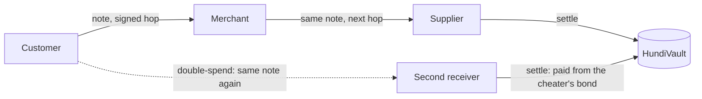

# How Hundi works

The [README](../README.md) is the short version. This file has the protocol, the gas numbers, the full limits and the full setup. The design record is in [`docs/ai/PLAN.md`](ai/PLAN.md) Appendix B.

The app says **Claim** where the contract says `settle`, and shows a USDT balance where the contract holds notes. A safety deposit is called a bond in the code.

## The protocol

The rule is one signature per slot. Each holder of a note may sign exactly one message at their place in the note's history. Two different messages at one slot prove a cheat.

1. **Online, before the outage.** A customer locks USDT in `HundiVault`, which mints notes and posts a safety deposit, called a bond in the code. Every device syncs a snapshot of notes and bonds.
2. **Offline.** The merchant shows a request QR. The customer scans it, signs one hop to the merchant's key, and shows a payment QR. The merchant checks it against the snapshot with no network.
3. **Offline again.** The merchant can spend the same note onward by signing the next hop.
4. **Online, on any device.** The holder calls `settle`, which pays them. If two different messages exist at one slot, the second settlement pays the victim from the double-signer's bond and burns the same amount.



Real settlements on chain 1874:

- [First settlement](https://explorer.testnet.whitechain.io/tx/0x4fa116315edde176eb4c8d5e0a39998f21e8791afb5bb9b2958ba3412e74ebab), 5 USDT out of the vault, signed with WebCrypto P-256 keys.
- [Through the relayer](https://explorer.testnet.whitechain.io/tx/0x6724decba19824a653c94e8557e3d106fcc4fdf94f18ed9667825cb0c257ac66), from a device holding no gas.
- [Direct](https://explorer.testnet.whitechain.io/tx/0xaee94522ed28b70cb12c74c9e83c9bb1fac84a3bcd83fa2c63b28ebccfbcbca8), with the relayer stopped.
- [A double-spend claim](https://explorer.testnet.whitechain.io/tx/0xc2d1f8fd58de4703724456dbeeae6fb27e0166e7a8974a8d905ce4585a9c8ec7), paid from the cheater's bond. The bond fell from 4 to 2 USDT, and 1 USDT burned. `scripts/story-check.ts` reproduces the whole story.

## Gas

The payer never holds WBT or writes down a seed phrase, and no payment screen names a chain. The network shows only behind a tap, on the Wallet sheet. The relayer pays the gas and takes a 0.10 USDT fee out of the payout, so a 5 USDT note pays 4.90. Measured gas cost is about 0.044 USDT for a settle and 0.074 USDT for a load.

The relayer earns USDT and spends WBT, so it buys its own gas on Uniswap. Below 0.1 WBT it swaps 2 USDT on the v3 pool. See the [README](../README.md#built-with).

These checks stop someone draining it:

- It accepts only `load` and `settle` calls to `HundiVault`.
- It simulates every call first with `eth_simulateV1`, and sends nothing that would fail.
- It reads the real payout from the simulated logs, and sends nothing unless the fee covers the gas.
- It limits each IP address to 20 requests a minute on each running instance.

A call can still revert if the chain changes between simulation and sending. The relayer loses that gas.

## The drop-in widget

`apps/shop` takes Hundi in the 21 lines of `apps/shop/src/main.ts`.

```ts
await registerHundiWorker();
await mountHundi(document.querySelector("#till"), {
  onVerdict: markOrderPaid,
  price: "5.00",
  role: location.hash === "#customer" ? "customer" : "merchant",
});
```

The till has a merchant view and a customer view. It works in airplane mode after one online visit, and it exports a settlement CSV for the accountant. The host page must serve `packages/wallet/hundi-sw.js` from its root. `price` must equal a note's face value, because a payment carries one note and gives no change.

The wallet shows money as a USDT balance, and a payment as Pending until it is claimed on-chain. The **Claim** button calls `settle`.

## Setup in full

You need [Bun](https://bun.sh) 1.4.4 and [Foundry](https://getfoundry.sh) 1.9.0.

```sh
git clone --recurse-submodules https://github.com/ratik21/hundi
cd hundi
bun inmerchant
bun run test
(cd contracts && forge test)
bun run --filter '@hundi/pwa' dev
```

The app opens on port 5173. The camera works only on `localhost` or HTTPS, so test on phones through an HTTPS URL. `bun run test` includes a story test that runs the whole demo on a local fork of Whitechain. It needs `anvil` from Foundry and skips itself without it.

The app needs no server of its own, so `bun run build` gives you a static site you can host anywhere.

To try all three parties with no phones, run `bun run lab`. It starts three wallets and the coffee shop on a local fork, with hot reload, at `localhost:5191` to `5194`. `bun run lab --ios` opens each wallet in its own iOS Simulator. `bun run lab:drive` runs the whole demo through the real screens and saves a screenshot of each step in `.lab/shots`. `bun run lab:shop` does the same for the coffee shop till. `bun run lab:sim` taps the wallet inside the iOS Simulators through `safaridriver`. A simulator has no camera, so lab builds pass QR codes through a local relay. Production builds leave that code out. `bun run lab --ios --testnet` runs the same wallets on the real testnet, one simulator each, and spends test funds from the relayer account.

To deploy your own vault, copy `.env.example` to `.env` and fill it in. Then run the commands below and put the result in `deployments/1874.json`.

```sh
cd contracts
FOUNDRY_PROFILE=deploy forge script script/Deploy.s.sol --rpc-url whitechain --broadcast \
  --verify --verifier blockscout --verifier-url https://explorer.testnet.whitechain.io/api/
```

Tests run on `osaka` because forge's local EVM has no `0x100` P-256 precompile before it. The deployed bytecode targets `prague`.

## CROPS in detail

Censorship resistance is the lead property. Offline payments need no server at all, and settlement works with the relayer switched off.

**C.** This project controls the two web domains, the relayer, and the default RPC choice. If the relayer stops or refuses a user, **Submit directly** settles from the device, which then needs its own gas. An inmerchanted app keeps working if the domains disappear, and it can still settle directly. If the Whitechain RPC refuses a user, reads fall back to Ankr, but direct sends have no second RPC today. The vault has no owner, so nobody can pause it or block a note.

**O.** MIT license. Anyone can build and run the whole project from this repo, including the relayer.

**P.** Reads go straight to the public RPC, which sees your IP address and which block ranges you read. `sync` reads every vault event, so syncing does not show which notes are yours. Adding money and settling do read your own key, address, and note, so the RPC can link those to your IP address. The relayer sees your IP address, the call, and your payout address. Vercel sees your IP address when you load the app. There are no analytics or trackers. Settled notes are public on-chain, so anyone can follow a note's keys through its history. Anon-RPC was tested for private reads, but [its gateway did not answer](ai/evidence/anon-rpc-getlogs.md), so reads are direct.

**S.** The P-256 key is a non-extractable WebCrypto key in IndexedDB, and it never leaves the phone. The funding key is a secp256k1 key held as plain text in IndexedDB, because WebCrypto cannot sign with that curve. There is no backup, so a lost phone or cleared site data loses its notes, its bond, and its funding key. You trust the snapshot from your last sync, the Whitechain sequencer, and the USDT issuer. The contract has not been audited.

## All known limits

Hundi does not stop a double-spend. It makes one provable and costly.

- `v` is a note's value, `B` is the cheater's bond, and `k` is how many people receive the same note. `X` is the sum of `(k - 1) * v` across their notes. The cheater's worst-case net gain is `X - B / 2`.
- An honest receiver can lose at most `v` per note.
- With a bond of `2v`, a two-way fork of one note nets the cheater zero, even if they win the claim race. Each further victim adds `v` to their gain.
- Nothing offline limits `k`. A cheater who defrauds several people in person before anyone settles can profit.
- A forwarder is weaker, because receivers check a bond against one note at a time. A merchant with a `2v` bond that forks `n` received notes nets `(n - 1) * v`.
- A victim is repaid only if they claim before the bond runs out. A cheater who races their own claim can beat them.
- Keys are free, so a burned key is abandoned. The bond is the only deterrent.
- A receiver refuses a note loaded after its last sync.
- A receiver needs no bond, but spending a note onward does.
- A note can pass through four hops. After that, its holder must settle online.
- The apps have no screens for `reclaim` or `withdrawBond`, although the contract has both.
- Whitechain is an L2 with a sequencer, and USDT can be frozen by its issuer.
- The relayer is one hosted function with one key. If it stops, direct settlement still works.
- The relayer orders its sends within one running instance only. Two instances can clash on a nonce or both refill at once. A retry fixes a clash.
- If the reply to a load is lost, the app forgets notes the chain may have minted. That money comes back only through `reclaim` after expiry, which has no screen.
